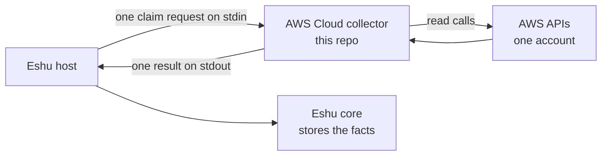

# eshu-collector-aws-cloud

Status: standalone collector, version `0.1.0`. The manifest still
declares three temporary placeholder fact kinds while the AWS port
finishes (see [PORT_PLAN.md](PORT_PLAN.md)).

One-line identity: an Eshu collector that reads AWS account data and
turns it into facts for Eshu core.

## What it is and why it exists

A collector is a program Eshu runs for one job at a time. This one looks at one AWS account, in named regions and services, and reports what exists: resources, links between them, and security-relevant settings. Eshu core stores and connects those reports later. Keeping AWS reads in their own collector lets core stay source-neutral, and lets this code ship and be pinned on its own.

Words: a claim is one unit of work with a time budget; a fact is one stored observation with a kind such as `aws_resource`; the host is the Eshu process that starts this collector. This collector never starts itself on a schedule.



Text version: the host sends one claim request. The collector reads
AWS, writes one result to stdout, and exits. The host commits the
facts. The collector writes nothing to Eshu storage itself.

## What it collects

Live mode reads control-plane metadata only — names, ids, and settings, never contents. Per `awscloud_doc.go` and `internal/live/doc.go`, it does not read secret values, message bodies, or parameter values, does not save raw policy documents, and calls no mutation (write) APIs. Access is bounded by three allowlists: one account, named regions, named services. Missing allowlists fail the run. Before reads, it checks with STS that the credentials belong to the target account.

Supported services (20, from `internal/live/config.go`): `apigateway`, `cloudfront`, `cloudwatchlogs`, `dynamodb`, `ec2`, `ecr`, `ecs`, `eks`, `elbv2`, `eventbridge`, `iam`, `lambda`, `kms`, `rds`, `route53`, `s3`, `secretsmanager`, `sns`, `sqs`, `ssm`. Other names are rejected. Reader depth varies by service; this list names what the code can read, not that every setting is reported.

### Fact kinds emitted

From `manifest.yaml` `spec.emittedFacts`: 15 kinds, all at schema
`1.0.0`. Confidence is `reported` unless noted.

| Kind | Plain meaning |
|---|---|
| `aws_resource` | One AWS thing (a bucket, a function, a VPC, ...) |
| `aws_relationship` | One link between two AWS things |
| `aws_image_reference` | One container image tag or digest seen in ECR |
| `aws_warning` | Something that could not be read, and what is missing |
| `s3_bucket_posture` | One bucket's safety settings summary |
| `aws_dns_record` | One Route 53 DNS record |
| `aws_security_group_rule` | One firewall rule on a security group |
| `aws_iam_permission` | One IAM permission statement |
| `aws_resource_policy_permission` | One permission statement from a resource policy |
| `ec2_instance_posture` | One EC2 instance's safety settings |
| `rds_instance_posture` | One RDS database instance's safety settings |
| `s3_external_principal_grant` | One bucket-policy grant to an outside account |
| `collector-aws-cloud.snapshot` | Temporary placeholder: file-mode snapshot marker |
| `collector-aws-cloud.record` | Temporary placeholder: one file-mode record (`observed`) |
| `collector-aws-cloud.warning` | Temporary placeholder: one file-mode warning |

The last three are transitional and are removed when the port completes. `aws_tag_observation` is not declared; the manifest notes it has no SDK schema yet.

## When to use it

Use it when Eshu should learn from live AWS APIs for one account at a time, under host-issued claims. Do not use it for data contents (objects, messages, secret values), for writes to AWS (it makes none), or to query answers back (core does that).

## How Eshu runs it

The image entry point is `/usr/local/bin/collector --sdk-stdio`. Per claim the host starts that process, writes one JSON request to stdin (`collector-sdk/v1alpha1` or `v1alpha3`), reads one JSON result from stdout, and commits it. The collector holds no endpoint, queue, or datastore handle.

Large results split into pages on `v1alpha3`: the host re-invokes the collector with a continuation cursor until the final page. A resumed call re-collects and checks the data still matches; drift fails the run so the host retries from the start. `v1alpha1` keeps the single-result shape.

Two modes: live mode (normal; config has no `source.input`) lists live AWS resources. File mode (`source.input` names a JSON report like `testdata/complete.json`) is for fixtures. A present-but-empty value counts as absent.

Local file-mode run, without a host:

```bash
go run ./cmd/collector --input testdata/complete.json
```

## How it works

Data in: one claim (ids, scope, attempt, deadline) plus config. Data out: one result holding facts, statuses, and a state: complete, partial (some reads denied), or terminal (failed for good).

Permission-denied rules: a denial on a core listing call fails that service's read. A denial on a small set of reviewed optional calls degrades instead — the result becomes partial, an `aws_warning` names the denied call, and the unread setting stays unknown rather than "off." Today that set is EC2 `DescribeSecurityGroupRules` and `DescribeImages`, EKS's `iam:ListOpenIDConnectProviders`, Lambda `ListEventSourceMappings`, and S3 `GetBucketEncryption`. A warning proves a thing was unread, never that it is absent.

## Configuration

Settings arrive in the host request config; the shape is shown in
[config.example.yaml](config.example.yaml). Live-mode fields (parsed
in `internal/live/config.go`):

| Field | Required | Meaning |
|---|---|---|
| `target_scopes.account_id` | Yes | One 12-digit AWS account per claim |
| `allowed_regions` | Yes | Non-empty region allowlist |
| `allowed_services` | Yes | Non-empty list from the 20 supported names |
| `target_scopes.assume_role` | No | Cross-account mode: `mode: central_assume_role`, `role_arn`, `external_id` |
| `source.sourceURI` | No | Label for emitted facts; defaults to `aws://<account>`; must carry no credentials |
| `source.redactionKeyEnv` | With `ecs` | Must be exactly `ESHU_AWS_REDACTION_KEY`; names the env var, never the key value |
| `freshness.previousDigest` | No | Prior digest hint (currently ignored on the live path) |
| `limits.maxRecordsPerClaim` | No | Fact cap per claim; default `5000` |
| `limits.maxPayloadBytes` | No | Bytes per fact payload; default `65536` |
| `limits.claimTimeoutSeconds` | No | Wall-time cap per claim; default `300` |
| `limits.maxPageBytes` | No | Bytes per result page; default `4128768` |

Claim and time budget: one claim must finish within
`claimTimeoutSeconds` (300 by default). A run that outruns it fails
instead of emitting late evidence. Defaults live in
`DefaultResourceUse` (`health.go`); `maxPageBytes` is the host's 4 MiB
stdout cap minus 64 KiB of framing. Raise it only together with the
host cap.

Credentials, exactly as the code allows: the ambient AWS chain only
(an instance or task role, IRSA web identity, or environment). Static
credential values in config are never accepted. With an `assume_role`
block, the collector exchanges ambient credentials through STS
AssumeRole for a role in the same account as the scope (a role
elsewhere is rejected) and keeps those session credentials in memory
for the claim. This repo does not publish an IAM policy; the reads it
makes are the list, describe, and get calls behind the services above,
and denials surface as failures or warnings — grant only what your
chosen services need, and no write actions.

One more boundary: environment values from ECS and Lambda, plus some
account contact fields, are redacted before any fact is built
(`awscloud_doc.go`). Source URIs that embed credentials are refused.

## Deploy

Build the image (pinned for `linux/amd64` in the Dockerfile):

```bash
docker build -t eshu-collector-aws-cloud .
```

The image holds `/usr/local/bin/collector`, the manifest at
`/etc/collector/manifest.yaml`, and the sample input at
`/var/lib/collector/complete.json`. It runs as user `65532` with entry
point `collector --sdk-stdio`. There is no port and no long-running
mode to deploy as a service; the host launches it per claim.

Install (seed) step, used by the host's component home:

```bash
collector seed --dest DIR --image-ref NAME@sha256:DIGEST
```

Seed writes `DIR/collector` and `DIR/manifest.yaml`, stamping the
digest-pinned image reference into the manifest (or the
`COLLECTOR_IMAGE_REF` environment value when the flag is absent).
Re-running it is safe. A malformed reference fails before any file is
written. This repo does not prove the core-side grant, install, and
enable commands; follow core's component docs for those, using
[grant.example.json](grant.example.json) as the grant request set.

Producer grants in plain words: a grant is core's permission record
saying "this producer, at this version, may emit this fact kind under
scope `aws`." Kinds owned by core need a live grant before the host
will commit them; `grant.example.json` requests 13 grants (one per
core kind at schema `1.0.0`, producer `collector-aws-cloud`, version
`0.1.0`). Note it includes `aws_tag_observation`, which the manifest
does not declare yet. Grants can be revoked core-side; rollback means
stopping new claims, revoking, restoring the prior producer, and
replaying from the last committed generation. Live grant issuance is a
core-side step this repo cannot prove.

## Eshu dependencies

- Needs: a host speaking `collector-sdk/v1alpha1` or `v1alpha3`, and
  AWS credentials as described above. Core compatibility in
  `manifest.yaml`: `>=0.0.5 <0.2.0`.
- Talks to: AWS service APIs (reads only) and its own stdin/stdout.
- Never touches: Postgres, the graph, queues, leases, or any Eshu API.
  `doc.go` states the import boundary and `boundary_test.go` enforces
  it: only the published SDK modules are imported (`eshu-sdk/collector
  v0.1.0-rc.4`, `eshu-sdk/factschema v0.1.0-rc.7`, from `go.mod`).

## Operations

Operator signals per run:

- stderr gets one health line: `collector health: {...}` with
  `alive`, `last_success_at`, `last_digest`,
  `consecutive_failures`, `last_error`, retry depth, and the effective
  limits actually in force.
- Exit code: non-zero on failure, with `collector: <error>` on stderr.
  Errors never echo URIs, payloads, or credentials.
- Result statuses ride in the committed result, which is what the host
  shows as collector status. A partial result with `aws_warning`
  facts means "read what we could; these calls were denied."
- The manifest declares a metrics prefix
  (`eshu_dp_aws_cloud_collector_`); this one-shot binary itself serves
  no metrics endpoint.

## Development

Go version is pinned in `go.mod` (`go 1.26.10`, module
`github.com/eshu-hq/eshu-collector-aws-cloud`). Tests run on fixtures
only; they never call live AWS.

```bash
make ci     # vet, lint, fmt, tidy, cap, build, test, race
make vet    # go vet
make lint   # golangci-lint (v2.12.2, via go run)
make build  # go build ./...
make test   # go test ./... -count=1
make race   # race suite
```

Releasing: `manifest.yaml` version and the git tag must match (`v0.1.0`
for `0.1.0`). A `v*` tag at the `main` head runs `release.yml`, which
builds, signs, and publishes the image with SBOM and provenance
records; pushes to `main` publish `:main`, `:latest`, and
`:sha-<long-sha>`. Manifest artifact references must be digest-pinned;
use `scripts/pin-digest.sh` when re-pinning.

## Docs and related

- [config.example.yaml](config.example.yaml) — annotated config shape.
- [manifest.yaml](manifest.yaml) — declared facts and runtime contract.
- [PORT_PLAN.md](PORT_PLAN.md) — the AWS port plan. [NOT_PORTED.md](NOT_PORTED.md) — what is not ported.
- [CONTRIBUTING.md](CONTRIBUTING.md) — local gates and CI lanes.
- [grant.example.json](grant.example.json) — grant request set.

## Contributing, security, license

See [CONTRIBUTING.md](CONTRIBUTING.md) before opening a pull request.
There is no SECURITY.md or LICENSE file in this repo; source files
carry `SPDX-License-Identifier: MIT`.
