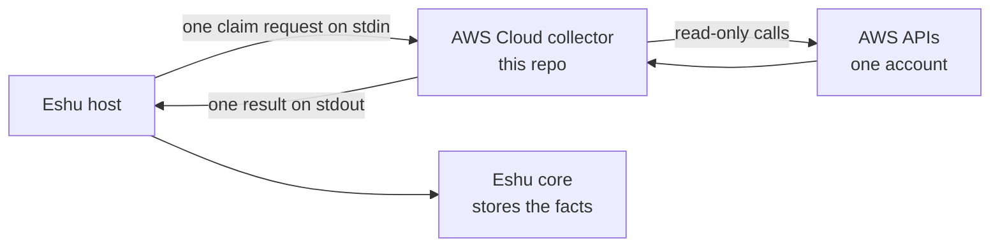

# eshu-collector-aws-cloud

Status: standalone collector, version `0.1.0`. The manifest still
declares three temporary placeholder fact kinds while the AWS port
finishes (see [PORT_PLAN.md](PORT_PLAN.md)).

In a nutshell: this is an Eshu collector that reads one AWS account
and reports what exists there. Resources, links between them, and
security-relevant settings, turned into facts for Eshu core to store
and connect later. It reads metadata only, makes no writes to AWS,
and never looks at data contents. Keeping the AWS reads in their own
collector lets core stay source-neutral, and lets this code ship and
be pinned on its own.



In words: the host sends one claim request, the collector reads AWS,
writes one result to stdout, and exits. The host commits the facts.
The collector writes nothing to Eshu storage itself, and it never
starts itself on a schedule.

## When you'd use it, and when you wouldn't

Use it when Eshu should learn from live AWS APIs for one account at
a time, under host-issued claims. Access is bounded by three
allowlists: one account, named regions, named services.

Don't use it for data contents (objects, messages, secret values),
for writes to AWS (it makes none), or to query answers back. Core
does the answering. This just reports what it saw.

## How Eshu runs it

Four lines cover it. The host starts the image entry point,
`/usr/local/bin/collector --sdk-stdio`, once per claim. It writes
one JSON request to stdin (`collector-sdk/v1alpha1` or `v1alpha3`)
with the claim and the config. The collector reads AWS and writes
one JSON result, or one page of it, to stdout. The host commits the
facts, and re-invokes with a cursor if more pages remain.

You can run the fixture mode locally without a host:

```bash
go run ./cmd/collector --input testdata/complete.json
```

## Documentation

| Doc | What's in it |
|---|---|
| [docs/README.md](docs/README.md) | Documentation index: start here |
| [docs/getting-started/README.md](docs/getting-started/README.md) | Run fixture mode locally, then see how the host runs it |
| [docs/guides/](docs/guides/README.md) | Operate, troubleshoot, seed, and release |
| [docs/concepts/](docs/concepts/README.md) | The claim contract and boundaries |
| [docs/reference/configuration.md](docs/reference/configuration.md) | Config fields, credentials, allowlists, and limits |
| [docs/reference/facts.md](docs/reference/facts.md) | Every emitted fact kind, mirroring the manifest |
| [docs/architecture/README.md](docs/architecture/README.md) | Where this collector sits in Eshu |
| [docs/diagrams/README.md](docs/diagrams/README.md) | Every diagram, with captions and text versions |
| [docs/decisions/README.md](docs/decisions/README.md) | Architecture decision records |
| [docs/contributing/README.md](docs/contributing/README.md) | Local gates before a pull request |
| [config.example.yaml](config.example.yaml) | Annotated config shape |
| [manifest.yaml](manifest.yaml) | Declared facts and the runtime contract |
| [PORT_PLAN.md](PORT_PLAN.md) and [NOT_PORTED.md](NOT_PORTED.md) | The AWS port plan, and what isn't ported yet |
| [CONTRIBUTING.md](CONTRIBUTING.md) | Local gates and CI lanes |

Terms, briefly: a claim is one unit of work with a time budget, a
fact is one stored observation with a kind like `aws_resource`, and
the host is the Eshu process that starts this collector.

## Related repos

- [eshu](https://github.com/eshu-hq/eshu): core. It issues claims,
  stores the facts, and answers questions over them. The manifest
  declares compatibility with core `>=0.0.5 <0.2.0`.
- [eshu-sdk](https://github.com/eshu-hq/eshu-sdk): the collector
  contract this binary speaks. `go.mod` pins `eshu-sdk/collector
  v0.1.0-rc.4` and `eshu-sdk/factschema v0.1.0-rc.7`.
- [eshu-extension-host](https://github.com/eshu-hq/eshu-extension-host):
  the standalone host that can run component collectors like this
  one.

## Development

Go `1.26.10` (pinned in `go.mod`). Run `make ci` for vet, lint,
format, tidy, the line cap, build, test, and race. Tests run on
fixtures only and never call live AWS.

## Contributing, security, license

See [CONTRIBUTING.md](CONTRIBUTING.md) before opening a pull
request. There's no SECURITY.md or LICENSE file in this repo. Source
files carry `SPDX-License-Identifier: MIT`.
