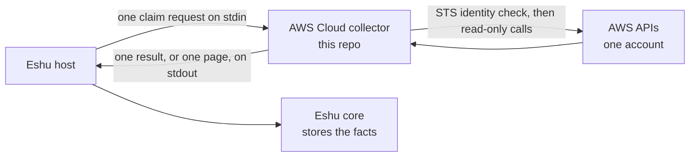
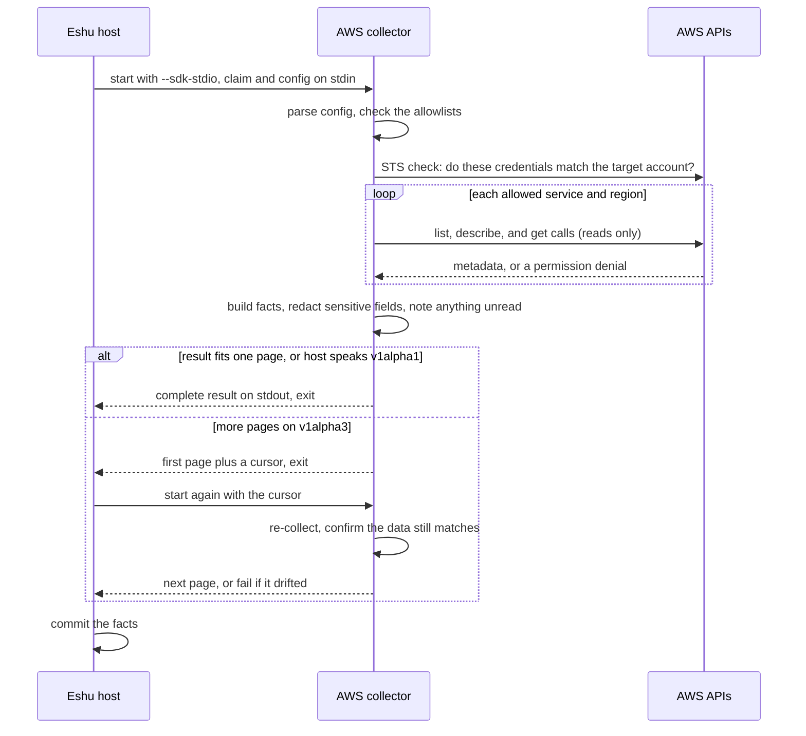

# Diagrams

Every diagram for `eshu-collector-aws-cloud` lives here,
each with a caption and a text version. Other pages link
here instead of copying diagrams. The
[top-level README](../../README.md) keeps the first overview
only.

## Where it sits

Caption: the host sends one claim request; the collector
checks its identity with STS, reads AWS metadata, and writes
one result (or one page) back. The host commits the facts.

Text version: Eshu host → (one claim request on stdin) →
AWS Cloud collector → (STS identity check, then read-only
calls) → AWS APIs, one account → metadata back to the
collector → (one result, or one page, on stdout) → host →
Eshu core stores the facts. The collector holds no endpoint,
queue, or datastore handle.

## One claim, start to finish

Caption: config and allowlists first, STS account check,
reads per service and region, then one result or paged
results with drift checking on resume.

Text version: the host starts the collector with
`--sdk-stdio` and the claim and config on stdin. The
collector parses config, checks allowlists, and verifies via
STS that credentials match the target account. It then makes
read-only list, describe, and get calls per allowed service
and region, builds facts with redaction, and notes anything
unread. A result that fits one page (or `v1alpha1`) goes out
whole. On `v1alpha3`, larger results page out with a cursor;
each resumed call re-collects and fails if the data drifted.
The host commits the facts.
